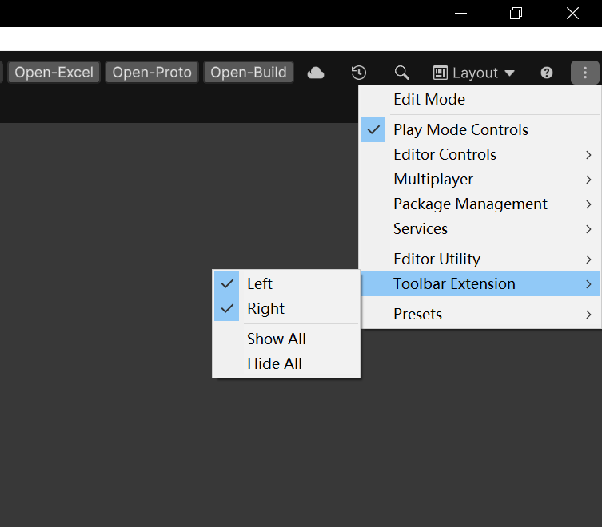

# Unity Toolbar

用于扩展 Unity 编辑器顶部 Toolbar。


## 安装方式

打开 Unity Package Manager，选择 **Add package from git URL**，然后输入：

```text
https://github.com/XuToWei/ToolbarExtension.git
```

## Unity 6000+ 额外设置

> 从 Unity 6000+ 开始，Toolbar 扩展需要在编辑器中手动启用；否则已注册的自定义按钮不会显示。

1. 点击编辑器顶部工具栏右侧的 **三点菜单（⋮）**。
2. 展开 **Toolbar Extension**。
3. 根据需要勾选 **Left** 或 **Right**；如需同时启用两侧，选择 **Show All**。



## 使用说明

在编辑器静态方法上添加 `Toolbar` 特性即可：

```csharp
[Toolbar(OnGUISide.Left, 0)]
static void OnToolbarGUI()
{
    if (GUILayout.Button("Test"))
    {
        Debug.Log("Test");
    }
}
```
